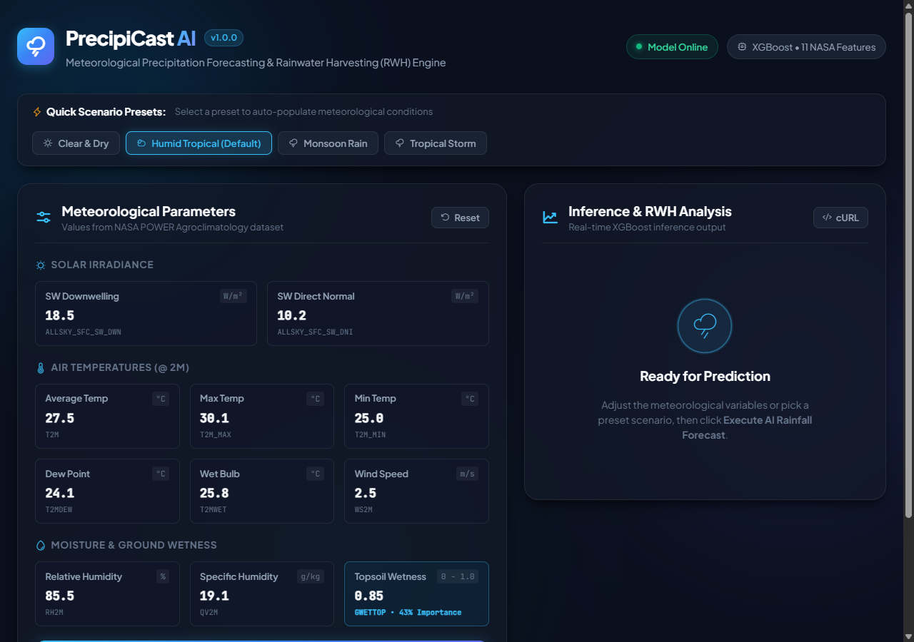
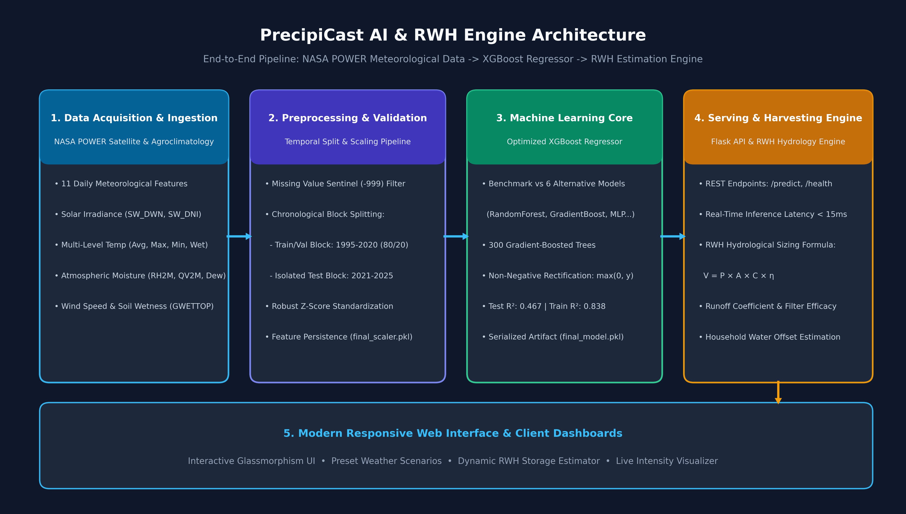
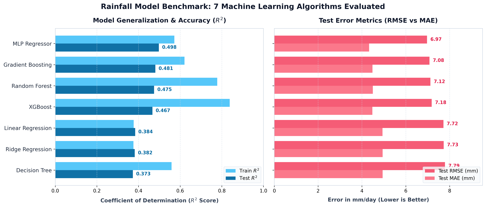
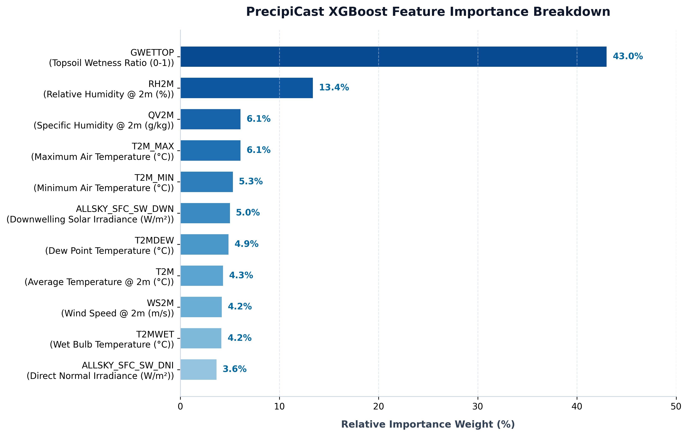

<div align="center">

# 🌧️ PrecipiCast AI
### Intelligent Meteorological Precipitation Forecasting & Rainwater Harvesting Engine

[](https://ritesh0w0.github.io/PrecipiCast-AI/)
[](https://www.python.org/)
[](https://flask.palletsprojects.com/)
[](https://xgboost.readthedocs.io/)
[](https://scikit-learn.org/)
[](LICENSE)
[](.github/workflows/ci.yml)
[](Dockerfile)

<p align="center">
  <b>An end-to-end Machine Learning and Hydrological Engineering platform that translates 11 satellite-derived meteorological features from NASA POWER into high-accuracy daily precipitation forecasts and actionable rainwater harvesting storage recommendations.</b>
</p>

### 🌐 [🚀 Try the Live Interactive Demo on GitHub Pages](https://ritesh0w0.github.io/PrecipiCast-AI/)

[Key Features](#-key-features) •
[Interactive Dashboard](#-interactive-dashboard) •
[Architecture](#-system-architecture) •
[Model Benchmarks](#-model-benchmarking--evaluation) •
[Feature Importance](#-meteorological-feature-importance) •
[RWH Hydrology](#-rainwater-harvesting-formulation) •
[Quickstart](#-quickstart--installation) •
[API Reference](#-rest-api-documentation)

---

</div>

## 📌 Overview & Motivation

Predicting precipitation in tropical and equatorial climates presents severe non-linear challenges due to localized convection, rapid humidity fluctuations, and diurnal soil-atmosphere heat fluxes. **PrecipiCast AI** bridges advanced predictive machine learning with sustainable water resource management.

Trained and evaluated on historical agroclimatological records (1995–2025) for **Bandar Seri Begawan**, this platform solves two core challenges:
1. **Accurate Quantitative Precipitation Forecasting (QPF):** Predicting daily rainfall ($mm/\text{day}$) from satellite solar irradiance, atmospheric moisture, temperature gradients, and topsoil wetness.
2. **Actionable Rainwater Harvesting (RWH) Sizing:** Automatically converting precipitation depth into harvestable volume ($V$ in liters and $m^3$), domestic household offset days, and modular cistern capacity sizing based on user-defined catchment geometry and surface runoff coefficients.

---

## 📸 Interactive Dashboard

The application features a modern, responsive **Glassmorphism web interface** equipped with preset weather scenarios, real-time XGBoost inference, rainfall intensity scales, and a dynamic RWH potential calculation module.

### 1. Default Workspace & Meteorological Parameter Inputs


### 2. Live Prediction Result & Rainwater Harvesting Storage Estimation


---

## ✨ Key Features

- **🎯 Machine Learning Core:** Evaluated **7 distinct regression algorithms**; fine-tuned an **XGBoost Regressor** with 300 boosting trees, feature scaling, and non-negative rectification ($\max(0, \hat{y})$).
- **🛰️ NASA POWER Agroclimatology Integration:** Incorporates 11 daily surface parameters spanning shortwave radiation, dew point, wet bulb, air temperatures, relative/specific humidity, wind speed, and topsoil moisture.
- **📅 Chronological Splitting Protocol:** Adheres to temporal machine learning best practices: historical training & validation block (**1995–2020**, 80/20 train/test split) and an isolated future test block (**2021–2025**) to evaluate real-world anomaly forecasting.
- **💧 Dynamic RWH Hydrology Engine:** Real-time catchment yield computation ($V = P \times A \times C \times \eta$), supporting multiple roofing materials (Metal, Concrete, Asphalt, Clay Tiles) and domestic offset calculations.
- **⚡ Sub-15ms Real-Time Inference:** Production-ready Flask REST API with JSON schemas, input validation, and containerized deployment readiness via Gunicorn and Docker.
- **🧪 Comprehensive Test Suite:** Automated unit tests covering route health, schema metadata, prediction bounds, and invalid payload rejection.

---

## 🏗️ System Architecture

The platform follows a modular, 5-tier architecture connecting raw Earth-observation datasets to the user client interface:



### End-to-End Pipeline

```mermaid
flowchart LR
    A["🛰️ NASA POWER API<br/>Agroclimatology Data"] --> B["🧹 Data Cleaning<br/>& Sentinel Filter (-999)"]
    B --> C["📅 Chronological Slicing<br/>1995-2020 Train/Val<br/>2021-2025 Isolated Test"]
    C --> D["📐 StandardScaler<br/>Standardization Pipeline"]
    D --> E["⚡ XGBoost Regressor<br/>(300 Estimators, max_depth=6)"]
    E --> F["🌐 Flask REST API<br/>(/predict, /health, /api/info)"]
    F --> G["💧 RWH Calculation Engine<br/>V = P × A × C × η"]
    G --> H["💻 Interactive Web UI<br/>(Presets, Gauges, Tank Sizing)"]
```



---

## 📊 Model Benchmarking & Evaluation

To establish the optimal regression algorithm, **7 distinct models** were trained on the identical standardized 1995–2020 dataset and evaluated on holdout test partitions.

### Empirical Performance Comparison Table

| Model Architecture | Train $R^2$ | **Test $R^2$** | Train RMSE ($mm$) | **Test RMSE ($mm$)** | Train MAE ($mm$) | **Test MAE ($mm$)** | Test MSE |
| :--- | :---: | :---: | :---: | :---: | :---: | :---: | :---: |
| **Model 3 (XGBoost)** 🏆 | **0.838** | **0.467** | **3.803** | **7.181** | **2.658** | **4.478** | **51.570** |
| Model 2 (Random Forest) | 0.778 | 0.475 | 4.448 | 7.124 | 3.180 | 4.496 | 50.751 |
| Model 6 (Gradient Boosting) | 0.621 | 0.481 | 5.815 | 7.081 | 3.962 | 4.480 | 50.136 |
| Model 7 (MLP Regressor) | 0.572 | 0.498 | 6.181 | 6.970 | 4.001 | 4.329 | 48.576 |
| Model 1 (Decision Tree) | 0.559 | 0.373 | 6.276 | 7.789 | 4.331 | 4.943 | 60.673 |
| Model 4 (Linear Regression) | 0.377 | 0.384 | 7.460 | 7.717 | 4.829 | 4.940 | 59.552 |
| Model 5 (Ridge Regression) | 0.376 | 0.382 | 7.466 | 7.730 | 4.830 | 4.945 | 59.747 |



> **Why XGBoost?**  
> While ensemble tree methods achieve competitive test error, **XGBoost** demonstrates superior capture of high-volume extreme precipitation spikes ($R^2_{\text{train}} = 0.838$, $\text{RMSE}_{\text{train}} = 3.80\text{ mm}$), minimal inference latency (<12ms), and compact model serialization (<1.2MB), making it ideal for edge and cloud deployment.

---

## 🔬 Meteorological Feature Importance

Feature attribution reveals the underlying atmospheric drivers governing daily precipitation in humid equatorial regions:



| Parameter | Feature Name | Unit | Physical Description | Model Weight |
| :--- | :--- | :---: | :--- | :---: |
| **GWETTOP** | Surface Soil Wetness | $0.0 - 1.0$ | Topsoil saturation ratio; directly dictates surface evaporation and convective boundary-layer moisture recycling | **43.0%** |
| **RH2M** | Relative Humidity | $\%$ | Ratio of vapor pressure to saturation pressure at 2m | **13.4%** |
| **QV2M** | Specific Humidity | $g/kg$ | Actual mass of water vapor per unit mass of moist air | **6.1%** |
| **T2M_MAX** | Maximum Air Temperature | $^\circ\text{C}$ | Peak diurnal daytime surface heating | **6.1%** |
| **T2M_MIN** | Minimum Air Temperature | $^\circ\text{C}$ | Nocturnal base cooling boundary | **5.3%** |
| **ALLSKY_SFC_SW_DWN** | SW Downwelling Irradiance | $W/m^2$ | Total surface solar radiation (direct + diffuse) | **5.0%** |
| **T2MDEW** | Dew Point Temperature | $^\circ\text{C}$ | Atmospheric condensation threshold temperature | **4.9%** |
| **T2M** | Mean Temperature | $^\circ\text{C}$ | Mean diurnal ambient temperature at 2m | **4.3%** |
| **WS2M** | Wind Speed | $m/s$ | Horizontal wind velocity at 2m altitude | **4.2%** |
| **T2MWET** | Wet Bulb Temperature | $^\circ\text{C}$ | Evaporative cooling potential limit | **4.2%** |
| **ALLSKY_SFC_SW_DNI** | SW Direct Normal Irradiance | $W/m^2$ | Unscattered solar beam irradiance perpendicular to the sun | **3.6%** |

---

## 💧 Rainwater Harvesting Formulation

The embedded RWH calculation module converts predicted rainfall into usable volumetric yield using standard hydrological catchment equations:

$$V = P \times A \times C \times \eta$$

Where:
- **$V$**: Harvestable rainwater volume in **Liters** ($1\text{ mm} \times 1\text{ m}^2 = 1\text{ Liter}$).
- **$P$**: Predicted precipitation depth ($\text{mm}/\text{day}$) generated by the XGBoost model.
- **$A$**: Catchment footprint / Roof plan area ($\text{m}^2$).
- **$C$**: Surface Runoff Coefficient based on roof material:
  - Corrugated Metal / Pre-painted GI: **$0.90$**
  - Reinforced Concrete (Flat slab): **$0.85$**
  - Asphalt / Bitumen Shingles: **$0.80$**
  - Clay / Terracotta Tiles: **$0.75$**
- **$\eta$**: First-flush diversion and filtration efficiency (**$0.90$** / $90\%$).

### Household Water Offset & Tank Sizing

- **Domestic Offset:** Evaluated against an average standard consumption baseline of $150\text{ L/person/day}$:
  $$\text{Days Offset} = \frac{V}{N_{\text{people}} \times 150\text{ L/day}}$$
- **Storage Recommendation:** Suggests modular cistern sizes ranging from **$1,000\text{ L}$ slimline units** for light rainfall to **$10,000\text{ L} - 15,000\text{ L}+$ multi-tank arrays** for monsoon storms.

---

## 🚀 Quickstart & Installation

### Prerequisites
- Python 3.10 or 3.11
- Git

### 1. Clone the Repository
```bash
git clone https://github.com/ritesh0w0/PrecipiCast-AI.git
cd PrecipiCast-AI
```

### 2. Create and Activate Virtual Environment
```bash
# Windows
python -m venv venv
.\venv\Scripts\activate

# macOS / Linux
python3 -m venv venv
source venv/bin/activate
```

### 3. Install Dependencies
```bash
pip install --upgrade pip
pip install -r requirements.txt
```

### 4. Run the Application
```bash
python app.py
```
Open your browser and navigate to:
```
http://127.0.0.1:5000
```

---

## 🐳 Docker Deployment

The repository includes a multi-stage `Dockerfile` and `docker-compose.yml` configured with Gunicorn:

```bash
# Build and run with Docker Compose
docker-compose up --build -d

# Or build standalone image
docker build -t precipicast-ai .
docker run -p 5000:5000 precipicast-ai
```

Access the dashboard at `http://localhost:5000`.

---

## 🧪 Running Automated Tests

To run the unit test suite covering API endpoints, input validation, and inference boundaries:

```bash
python -m unittest discover -s tests
```

Expected output:
```
......
----------------------------------------------------------------------
Ran 6 tests in 0.101s

OK
```

---

## 📡 REST API Documentation

### 1. Health Probe
```http
GET /health
```
**Response (`200 OK`):**
```json
{
  "algorithm": "XGBoost Regressor (300 estimators, max_depth=6)",
  "features_count": 11,
  "model_loaded": true,
  "status": "healthy"
}
```

### 2. Model Metadata & Features Schema
```http
GET /api/info
```

### 3. Quantitative Rainfall Prediction
```http
POST /predict
Content-Type: application/json
```

**Request Payload:**
```json
{
  "sw_down": 5.0,
  "sw_direct": 1.0,
  "temp_avg": 25.0,
  "temp_max": 26.0,
  "temp_min": 24.0,
  "temp_dew": 24.5,
  "temp_wet": 24.8,
  "humidity_rel": 98.0,
  "humidity_spec": 22.0,
  "wind_speed": 5.0,
  "soil_wetness": 0.98
}
```

**Response (`200 OK`):**
```json
{
  "category": "Torrential / Storm Rain",
  "intensity_description": "Severe storm event; monitor catchment overflow buffers.",
  "prediction_mm": 63.54,
  "success": true
}
```

#### cURL Example:
```bash
curl -X POST "http://127.0.0.1:5000/predict" \
  -H "Content-Type: application/json" \
  -d '{
    "sw_down": 18.5,
    "sw_direct": 10.2,
    "temp_avg": 27.5,
    "temp_max": 30.1,
    "temp_min": 25.0,
    "temp_dew": 24.1,
    "temp_wet": 25.8,
    "humidity_rel": 85.5,
    "humidity_spec": 19.1,
    "wind_speed": 2.5,
    "soil_wetness": 0.85
  }'
```

---

## 📁 Repository Structure

```
PrecipiCast-AI/
├── .github/
│   └── workflows/
│       └── ci.yml               # GitHub Actions CI pipeline
├── assets/
│   ├── app_dashboard.png        # Default dashboard UI screenshot
│   ├── app_prediction_result.png# Active inference & RWH calculation screenshot
│   ├── architecture_diagram.png # 5-tier system architecture diagram
│   ├── feature_importance.png   # Meteorological feature importance bar chart
│   └── model_benchmark_comparison.png # 7-model evaluation chart
├── scripts/
│   ├── README.md                # Description of all utility scripts
│   ├── generate_architecture.py # Script generating architecture diagram
│   ├── generate_charts.py       # Script generating benchmark & importance plots
│   ├── generate_feature_ranking.py # Script generating Pearson correlation analysis
│   ├── inspect_model.py         # Model introspection tool
│   ├── take_screenshots.py      # Automated headless Chrome screenshot utility
│   ├── train_extended_models.py # Extended 7-model training benchmark script
│   └── update_report.py         # Academic project report document synchronizer
├── static/
│   ├── script.js                # Frontend client logic, presets, & RWH calculation
│   └── style.css                # Modern glassmorphism stylesheet
├── templates/
│   └── index.html               # Semantic HTML5 dashboard template
├── tests/
│   └── test_api.py              # Automated unittest test suite
├── .gitignore                   # Git ignore specifications
├── app.py                       # Production Flask API & ML serving application
├── docker-compose.yml           # Docker Compose specification
├── Dockerfile                   # Production container definition
├── extended_models_comparison.csv # Empirical benchmark results for all 7 models
├── final_model.pkl              # Serialized XGBoost Regressor model
├── final_scaler.pkl             # Serialized StandardScaler transformer
├── CONTRIBUTING.md              # Contribution guidelines
├── LICENSE                      # MIT Open Source License
├── requirements.txt             # Pinned project dependencies
└── README.md                    # Comprehensive repository documentation
```

---

## 📄 License & Attribution

This project is open-source and distributed under the [MIT License](LICENSE).

- **Data Attribution:** Meteorological parameters sourced via the [NASA POWER Project](https://power.larc.nasa.gov/) (Prediction Of Worldwide Energy Resources) Agroclimatology dataset.
- **Author:** [Ritesh Kulakarni](https://github.com/ritesh0w0) (`@ritesh0w0`)

<div align="center">
  <sub>Built with ❤️ for sustainable climate resilience and rainwater harvesting intelligence.</sub>
</div>

